# ПР №5-7. Безпечний мережевий застосунок (Secure Net App)

[](https://github.com/tskondratiukfitm23-debug/pr57-secure-net-app/actions/workflows/security.yml)

Виконав: **Кондратюк Т.С.**, група 22340, Університет Грінченка.
Курс «Комплексні системи захисту інформації: проектування, впровадження, супровід».

Клієнт-серверний застосунок на **FastAPI + requests** з такими механізмами захисту:

| № | Механізм | Де в коді |
|---|----------|-----------|
| 1 | Два вузли: сервер `127.0.0.10`, клієнт `127.0.0.20` (+ варіант docker-compose `172.28.0.10/20`) | `scripts/run_local.sh`, `docker-compose.yml`, [docs/topology.md](docs/topology.md) |
| 2 | Протокол запит-відповідь (JSON echo) по відкритому HTTP | `POST /echo-http`, `client.py echo --http` |
| 3 | TLS 1.2+/1.3, власний CA (RSA-4096) → серверний сертифікат ECDSA P-256 із SAN; клієнт перевіряє ланцюжок і ім'я | `server/scripts/gencerts.sh`, `client.py tls-info` |
| 4 | Облікові записи, bcrypt (cost 12), політика паролів, ролі `user`/`admin` | `server/security.py` |
| 5 | JWT HS256 (access 15 хв, refresh 8 год, ротація, відкликання, iss/aud/jti/typ) | `server/security.py`, `client.py bypass` |
| 6 | JSONL-журнал подій із маскуванням секретів; фільтри за типом/категорією/часом/користувачем/IP | `server/logger_setup.py`, `GET /admin/logs`, `tools/analyze_logs.py` |
| 7 | Rate limit: token bucket на IP (30, +15/с) + блокування облікового запису після 5 невдач (60 с ×2, до 1 год) | `server/ratelimit.py` |
| 8 | MFA TOTP (RFC 6238), QR-код, захист від повторного використання коду | `/auth/mfa/*`, `/auth/login/otp` |
| 9 | CI: Bandit (SAST), pip-audit (SCA), pytest, E2E на кожен push | `.github/workflows/security.yml` |
| 10 | Бенчмарк HTTP vs HTTPS (p50/p95/p99) | `client/bench.py`, [docs/analysis.md](docs/analysis.md) |

## Швидкий старт (Linux / WSL / macOS)

```bash
pip install -r requirements.txt
bash server/scripts/gencerts.sh 127.0.0.10      # CA + сертифікат сервера
python -m server.scripts.create_users --reset   # alice, bob (user), admin (admin)
bash scripts/run_local.sh                       # HTTP :8080 і HTTPS :8443 на 127.0.0.10

export SNA_HOST=127.0.0.10 SNA_CA=server/certs/ca.crt SNA_SRC=127.0.0.20
C="python client/client.py"
$C echo --http --msg "hi"                       # відкритий канал (Завдання 2)
$C plain-auth                                   # логін по HTTP → 403 TLS required
$C tls-info                                     # параметри рукостискання
$C login --user alice --password 'Alice-Passw0rd!'
$C whoami ; $C bypass ; $C refresh ; $C logout
$C mfa-setup ; $C mfa-confirm --otp <код>       # MFA
$C brute --user bob --wrong 8 ; $C flood --n 300
$C login --user admin --password 'Admin-Passw0rd!' && $C logs --event auth.fail --since 30m
python tools/analyze_logs.py
python client/bench.py --n 300
```

Docker (два контейнери в окремій мережі): `JWT_SECRET=$(openssl rand -base64 48) docker compose up -d --build`,
далі `docker compose exec client python client/client.py tls-info`.

> Демо-паролі (`Alice-Passw0rd!` тощо) призначені лише для лабораторного стенду. `users.json`, ключі та сертифікати
> генеруються локально і в репозиторій не потрапляють (`.gitignore`).

## Тести та перевірки безпеки

```bash
pip install -r requirements-dev.txt
pytest -v                                  # 18 тестів
bandit -r server client tools              # 0 проблем
pip-audit -r requirements.txt              # No known vulnerabilities found
```

## Документація
- [docs/topology.md](docs/topology.md) — вузли, адреси, порти, потоки даних
- [docs/security.md](docs/security.md) — TLS, автентифікація, JWT, MFA, rate limit, журнали, CI; що виправлено порівняно з шаблоном
- [docs/analysis.md](docs/analysis.md) — продуктивність HTTP vs HTTPS, підсумкова оцінка захищеності

## Скріншоти

| | |
|---|---|
| 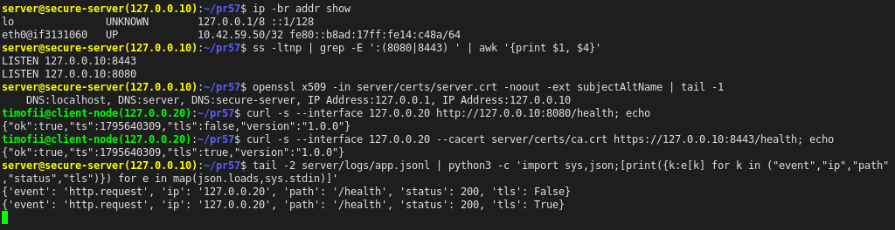 Топологія | 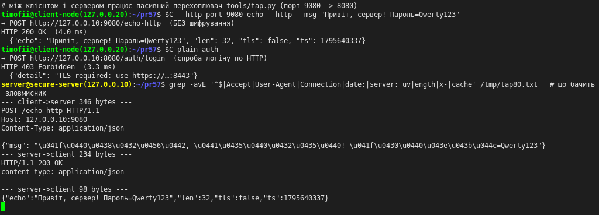 HTTP: дані видно |
| 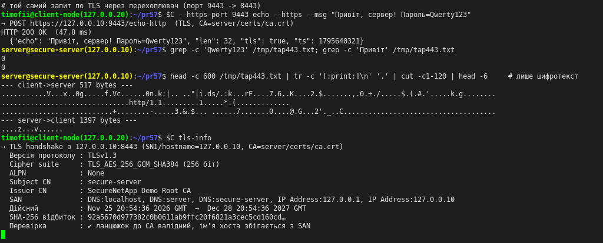 HTTPS: лише шифротекст | 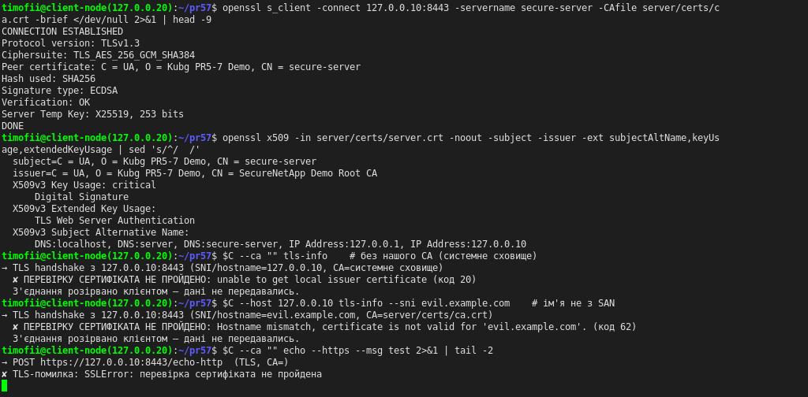 Перевірка сертифіката |
| 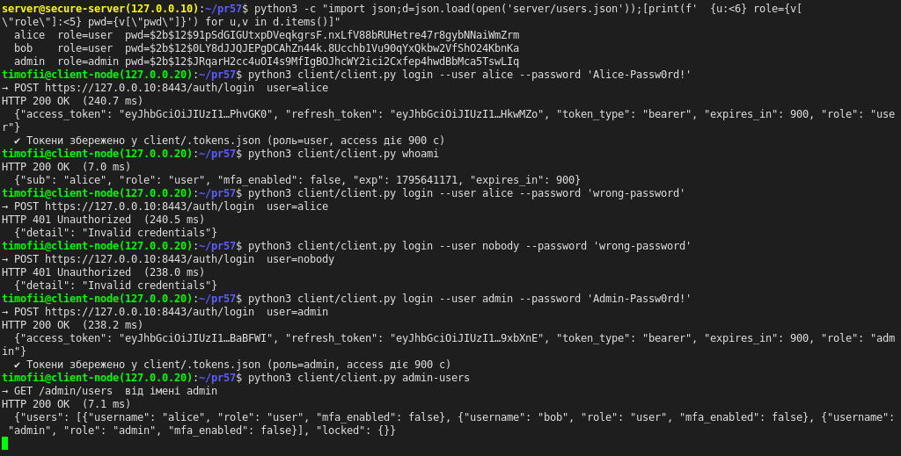 bcrypt і ролі | 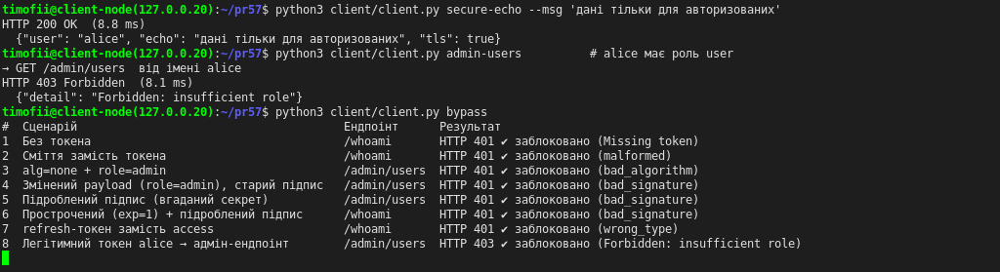 Спроби обходу JWT |
| 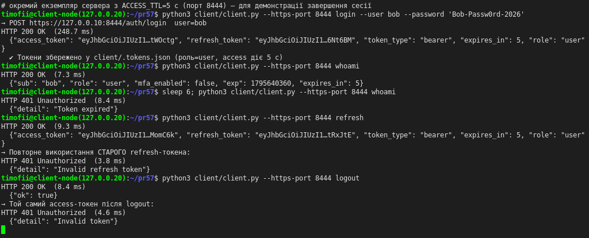 Строк дії, refresh, logout | 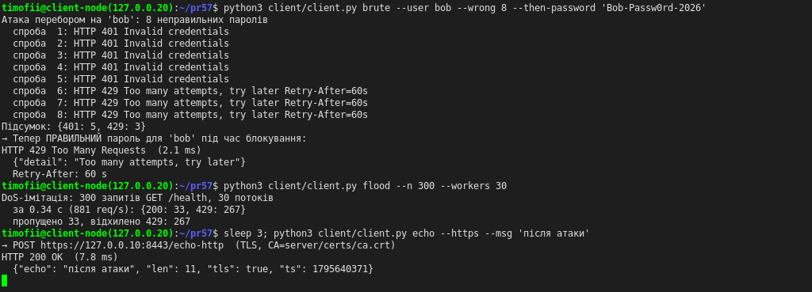 Brute force / DoS |
| 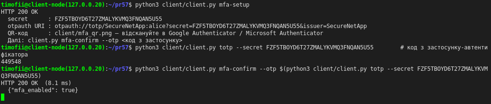 MFA: налаштування | 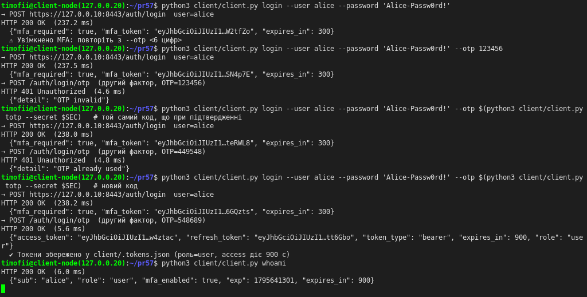 MFA: вхід |
| 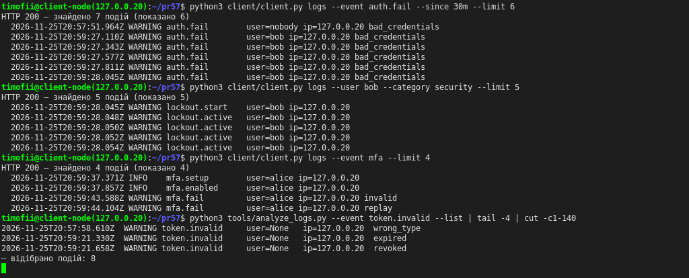 Фільтри журналу | 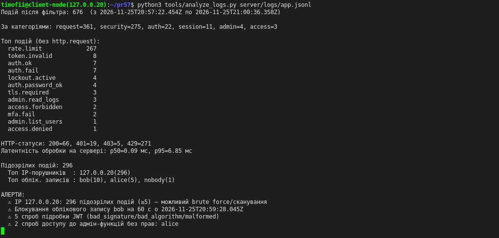 Аналіз журналу |
| 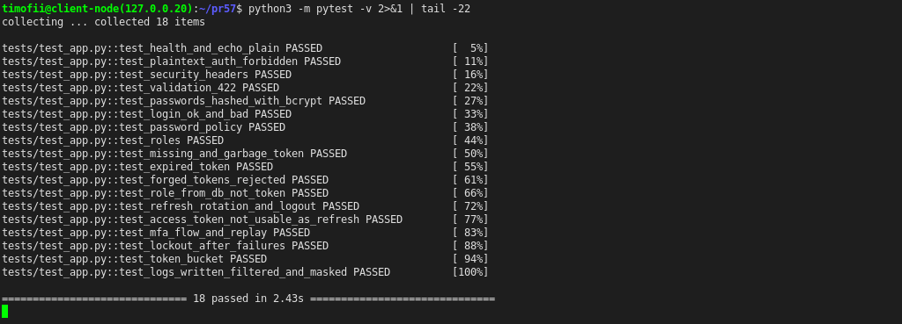 pytest | 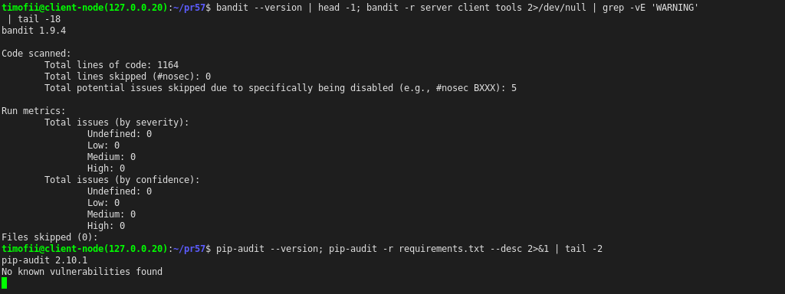 Bandit, pip-audit |
| 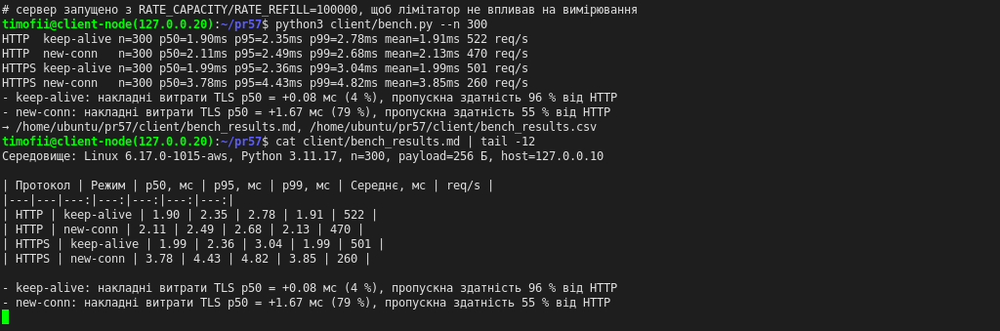 Бенчмарк | 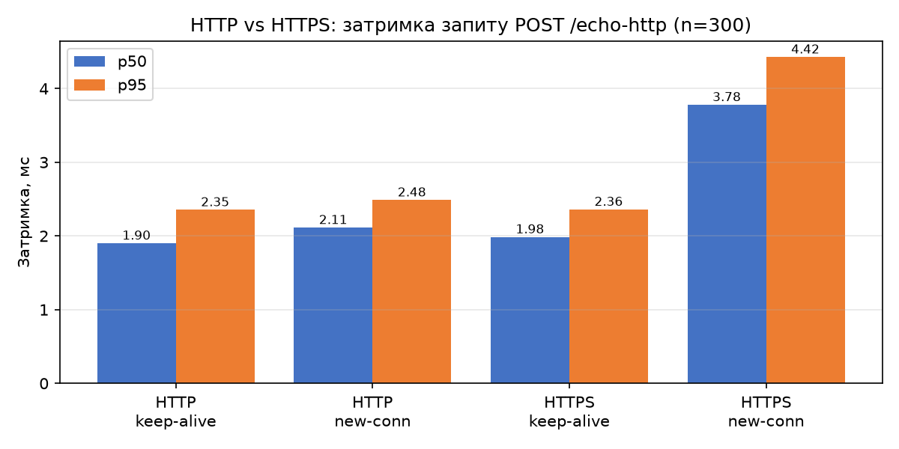 Графік p50/p95 |
