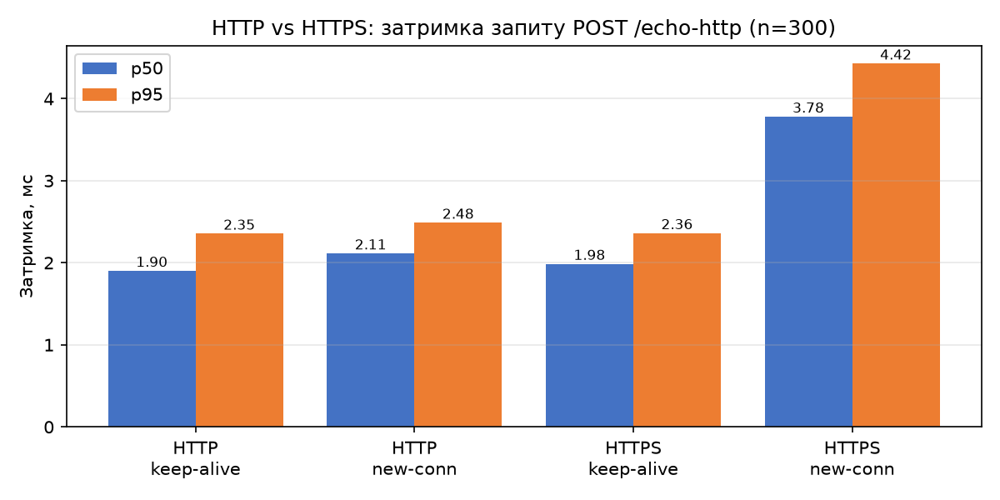

# Аналіз: продуктивність і рівень захищеності

## HTTP vs HTTPS (`client/bench.py --n 300`, payload 256 Б, Linux, Python 3.11, loopback)

| Протокол | Режим | p50, мс | p95, мс | p99, мс | req/s |
|---|---|---:|---:|---:|---:|
| HTTP | keep-alive | 1.90 | 2.35 | 2.78 | 522 |
| HTTPS | keep-alive | 1.99 | 2.36 | 3.04 | 501 |
| HTTP | нове з'єднання | 2.11 | 2.49 | 2.68 | 470 |
| HTTPS | нове з'єднання | 3.78 | 4.43 | 4.82 | 260 |

- При повторному використанні з'єднання накладні витрати TLS мізерні: **+0.08 мс (4 %)** до p50, 96 % пропускної здатності HTTP.
- Основна ціна TLS — рукостискання: при новому з'єднанні на кожен запит **+1.67 мс (≈79 %)** до p50, пропускна здатність 55 % від HTTP.
- Висновок: використовувати keep-alive / пул з'єднань, TLS 1.3 (1-RTT), ECDSA-сертифікат (швидший за RSA при підписі);
  за потреби — session resumption. Вимірювання на loopback: у реальній мережі до рукостискання додається 1 RTT.
- Лімітатор під час вимірювань було піднято (`RATE_CAPACITY/RATE_REFILL=100000`), інакше бенчмарк сам отримував би 429.

## Підсумкова оцінка захищеності

| Загроза | Захист | Перевірено |
|---|---|---|
| Перехоплення / підміна трафіку | TLS 1.3, перевірка CA і SAN, HSTS, auth лише по HTTPS | tap.py: у HTTP видно пароль, у HTTPS 0 збігів |
| Викрадення бази паролів | bcrypt cost 12 + сіль | різні хеші, `$2b$12$` |
| Підробка / повтор токенів | HS256 із сильним секретом, iss/aud/typ/jti, denylist, короткий TTL | 8 сценаріїв bypass + тести |
| Ескалація привілеїв | RBAC, роль із БД | 403 для user на /admin |
| Підбір пароля | блокування облікового запису + ліміт на IP | 5×401 → 429 |
| DoS (рівень застосунку) | token bucket на IP | 267/300 відхилено |
| Компрометація пароля | TOTP MFA, захист від replay | невірний/повторний код → 401 |
| Непомічені атаки | структуровані логи, алерти analyze_logs | алерти brute force, JWT forgery |
| Вразливий код / залежності | Bandit + pip-audit у CI | 0 проблем |

## Що можна покращити
1. Зберігати стан лімітатора та denylist у Redis (зараз — у пам'яті процесу, скидається при перезапуску й не ділиться між воркерами).
2. Асиметричний підпис JWT (RS256/EdDSA) і ротація ключів (`kid`), щоб інші сервіси могли перевіряти токени без секрету.
3. mTLS для службових клієнтів; OCSP/CRL для відкликання сертифікатів; сертифікати від ACME у продакшні.
4. Шифрування TOTP-секретів у сховищі (KMS), резервні коди відновлення MFA, WebAuthn як сильніший фактор.
5. DDoS мережевого рівня — на reverse-proxy/CDN (nginx `limit_req`, Cloudflare), а не лише в застосунку.
6. Відправлення логів у SIEM (ELK/Loki) з алертами в реальному часі; цілісність журналу (append-only, підпис).
7. Додати в CI Semgrep, сканування секретів (gitleaks), DAST (OWASP ZAP) і сканування Docker-образу (Trivy).
